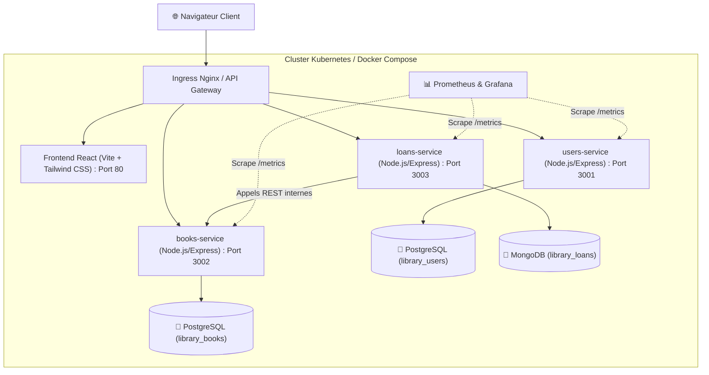

# 📚 Système de Gestion de Bibliothèque Universitaire

> **Projet semestriel du Master DevOps & Cloud (ISET Tozeur, 2026/2027)**
> Réalisé par **Nour Kidoudi** et **Maryem Elheni**

Plateforme moderne de gestion documentaire universitaire conçue selon une **architecture microservices distribuée**, prête pour la conteneurisation Docker et le déploiement sur cluster Kubernetes (avec GitOps ArgoCD, monitoring Prometheus & Grafana).

---

## 🏗️ Architecture Globale du Projet



---

## ⚙️ Les Microservices & Rôles

| Composant | Technologie | Persistance | Port | Rôles & Responsabilités |
| :--- | :--- | :--- | :--- | :--- |
| **`users-service`** | Node.js, Express, Sequelize | PostgreSQL | `3001` | Inscription, connexion, génération JWT (Access + Refresh), gestion des rôles (`student`, `librarian`, `admin`), rate limiting, métriques Prometheus. |
| **`books-service`** | Node.js, Express, Sequelize | PostgreSQL | `3002` | Catalogue des ouvrages, recherche plein texte, filtres par discipline, gestion des stocks, avis et notations, téléversement de couvertures, métriques. |
| **`loans-service`** | Node.js, Express, Mongoose | MongoDB | `3003` | Emprunts, restitutions, prolongations, pénalités, notifications aux emprunteurs et au personnel actif, rappels planifiés à 08:00 (Africa/Tunis), statistiques. |
| **`frontend`** | React 18, Vite, Tailwind CSS, Nginx | - | `80` | Interface responsive au thème clair Scriptarium, visualisations Recharts et gestion des droits selon le rôle connecté. |

---

## 🚀 Démarrage Rapide avec Docker Compose

### 1. Prérequis
- [Docker Engine & Docker Compose](https://docs.docker.com/get-docker/) (v20+)
- Node.js 20+ (uniquement en cas de développement hors conteneur)

### 2. Lancement de la stack complète
À la racine du projet `bibliotheque-devops/` :

```bash
# Lancement de l'ensemble des conteneurs (bases de données + microservices + frontend)
docker-compose up -d --build
```
Ou avec le Makefile :
```bash
make up
```

### 3. Initialiser les données de démonstration (Seeders)
Pour injecter l'administrateur, les utilisateurs de test et plus de 20 livres universitaires :

```bash
make seed
```
*(ou manuellement)* :
```bash
docker-compose exec users-service node seed.js
docker-compose exec books-service node seed.js
```

### 4. Accès aux interfaces et services

- **Frontend Web** : [http://localhost](http://localhost) (Port 80)
- **Users Service API** : `http://localhost:3001/api`
- **Books Service API** : `http://localhost:3002/api`
- **Loans Service API** : `http://localhost:3003/api`
- **Healthchecks** :
  - `http://localhost:3001/health`
  - `http://localhost:3002/health`
  - `http://localhost:3003/health`

---

## 🔑 Comptes de Démonstration Pré-configurés

| Profil | Email | Mot de Passe | Permissions |
| :--- | :--- | :--- | :--- |
| **Administrateur** | `admin@library.com` | `Admin123!` | Accès total : gestion des utilisateurs, rôles, catalogue, statistiques globales. |
| **Bibliothécaire** | `librarian@library.com` | `Librarian123!` | Gestion du catalogue (ajout/modification de livres), gestion et retour des emprunts, encaissement des pénalités. |
| **Étudiant** | `student@university.com` | `Student123!` | Consultation du catalogue, emprunt d'ouvrages (limite 5), prolongation (+14j), historique et notifications. |

*(Des boutons de connexion rapide en un clic sont également intégrés directement sur la page de connexion)*

---

## 📁 Structure du Projet

```text
bibliotheque-devops/
├── users-service/           # Microservice Utilisateurs & Auth (Node.js/PostgreSQL)
│   ├── src/
│   │   ├── config/          # Sequelize & JWT
│   │   ├── middleware/      # Auth JWT, Rate Limiter, Validation
│   │   ├── models/          # User (UUID, bcrypt, rôles)
│   │   ├── routes/          # /auth et /users
│   │   └── utils/           # Prometheus metrics & Token utils
│   ├── Dockerfile
│   └── seed.js
│
├── books-service/           # Microservice Livres & Catalogue (Node.js/PostgreSQL)
│   ├── src/
│   │   ├── config/          # Sequelize
│   │   ├── middleware/      # Auth, Multer (uploads), Validations
│   │   ├── models/          # Book, Category, Review
│   │   ├── routes/          # /books et /categories
│   │   └── utils/           # Prometheus metrics
│   ├── Dockerfile
│   └── seed.js              # Données de test (20+ livres académiques)
│
├── loans-service/           # Microservice Emprunts & Notifications (Node.js/MongoDB)
│   ├── src/
│   │   ├── config/          # Mongoose
│   │   ├── models/          # Loan, Notification, LoanStats
│   │   ├── routes/          # /loans, /notifications, /stats
│   │   ├── services/        # BookService (REST client), CronJobs, Notifications
│   │   └── utils/           # Prometheus metrics
│   └── Dockerfile
│
├── frontend/                # Interface Utilisateur React 18 (Vite + Tailwind CSS + Nginx)
│   ├── src/
│   │   ├── components/      # UI Glassmorphism, Layout, Cards, Modals, Charts
│   │   ├── contexts/        # AuthContext (JWT session)
│   │   ├── pages/           # Dashboard, Catalogue, Emprunts, Admin Utilisateurs, Profil
│   │   └── services/        # Clients Axios vers les microservices
│   ├── nginx.conf           # Reverse proxy et routage SPA
│   └── Dockerfile
│
├── docs/
│   ├── api-reference.md     # Spécification détaillée des endpoints REST
│   └── architecture.md      # Schémas et documentation technique
│
├── docker-compose.yml       # Déploiement multi-conteneurs pour production locale
├── docker-compose.dev.yml   # Configuration de développement avec rechargement à chaud
├── Makefile                 # Raccourcis de commandes utiles
├── .env                     # Variables d'environnement globales
└── README.md
```

---

## 🛠️ Commandes Utiles (Makefile)

```bash
make up         # Démarrer tous les conteneurs en arrière-plan
make down       # Arrêter et supprimer les conteneurs
make logs       # Afficher les logs en temps réel de tous les services
make seed       # Injecter les données de test
make build      # Reconstruire les images Docker
make clean      # Nettoyer complètement (images, volumes, conteneurs)
```

---

## 🛡️ DevOps & Déploiement Kubernetes Prévu

Tous les services disposent de :
1. **Dockerfiles multi-étapes (`multi-stage`)** basés sur Alpine Linux pour des images légères (<150 Mo), sécurisées et exemptes de vulnérabilités critiques (compatibles scans Trivy).
2. **Endpoints de santé `/health`** compatibles avec les `livenessProbe` et `readinessProbe` de Kubernetes.
3. **Endpoints Prometheus `/metrics`** pour l'ingestion automatique par Prometheus Operator.
4. **Configuration Nginx optimisée** servant de passerelle et gérant la compression gzip et le cache statique.
