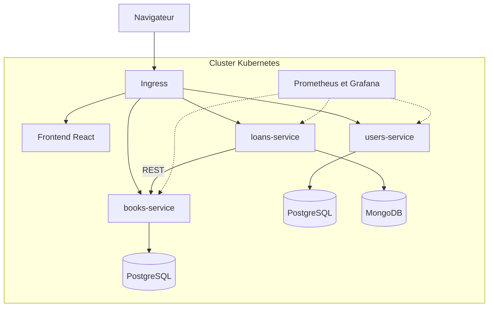
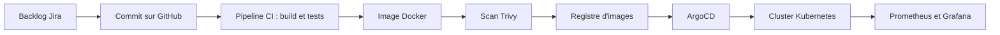

# Architecture technique - Gestion de bibliothèque

Projet semestriel du Master DevOps & Cloud (ISET Tozeur, 2026/2027)
Réalisé par Nour Kidoudi et Maryem Elheni.

## 1. Vue d'ensemble

L'application de gestion de bibliothèque est découpée en trois microservices indépendants et un frontend React, déployés sur un cluster Kubernetes. Chaque service possède sa propre base de données et peut être déployé séparément.



## 2. Microservices

| Service | Rôle | Technologie | Persistance | Port prévu |
|---|---|---|---|---|
| users-service | Inscription, connexion, JWT, rôles (étudiant, bibliothécaire, admin) | Node.js, Express | PostgreSQL | 3001 |
| books-service | Catalogue, recherche, disponibilité du stock | Node.js, Express | PostgreSQL | 3002 |
| loans-service | Emprunts, retours, retards, rappels | Node.js, Express | MongoDB | 3003 |
| frontend | Interface web (connexion, catalogue, emprunts, tableau de bord) | React, Nginx | aucune | 80 |

## 3. Communication entre services

- Les échanges se font en REST (HTTP/JSON).
- users-service émet un token JWT à la connexion. Les autres services vérifient ce token avant de traiter une requête.
- loans-service appelle books-service pour vérifier et mettre à jour le stock lors d'un emprunt ou d'un retour.
- Aucun service ne lit directement la base de données d'un autre service.

## 4. Choix technologiques et justifications

| Élément | Choix | Justification |
|---|---|---|
| Backend | Node.js + Express | Une seule stack pour les trois services, léger, démarrage rapide |
| Frontend | React | Interface dynamique, composants réutilisables |
| Bases de données | PostgreSQL et MongoDB | Relationnel pour utilisateurs et livres, document pour les emprunts |
| Authentification | JWT | Sans état, vérifiable par chaque service sans appel supplémentaire |
| Gestion de code | GitHub | Pull requests, revue de code, intégration avec la CI |
| Intégration continue | GitHub Actions ou Jenkins (choix à confirmer en semaine 6) | Build, tests et packaging automatiques à chaque commit |
| Conteneurisation | Docker | Empaquetage identique en local et en production |
| Sécurité des images | Trivy | Scan des vulnérabilités, échec du pipeline en cas de faille critique |
| Orchestration | Kubernetes | Déploiement et gestion des conteneurs à l'échelle |
| Déploiement continu | ArgoCD | GitOps : le cluster reflète automatiquement l'état du dépôt Git |
| Supervision | Prometheus et Grafana | Collecte de métriques, tableaux de bord et alertes |
| Gestion de projet | Jira | Backlog, sprints, suivi de l'avancement |

## 5. Chaîne DevOps cible



## 6. Stratégie de branches

- `main` : branche stable, protégée par un ruleset GitHub. Aucun push direct, une pull request avec au moins une approbation est obligatoire.
- `dev` : branche d'intégration où sont fusionnées les fonctionnalités terminées.
- `feature/...` : une branche par fonctionnalité ou par tâche, créée depuis `dev`.
- Chaque pull request est relue par l'autre membre du binôme avant fusion.
- Convention de messages de commit : `feat:`, `fix:`, `docs:`, `chore:`.

## 7. Structure du dépôt (mono-repo)

```
bibliotheque-devops/
├── users-service/
├── books-service/
├── loans-service/
├── frontend/
├── k8s/            (manifests Kubernetes)
├── docs/           (documentation technique)
├── docker-compose.yml
└── README.md
```

## 8. Planning des sprints

| Sprint | Dates | Contenu |
|---|---|---|
| Sprint 1 | 12 oct - 26 oct | Cadrage, backlog, architecture, dépôts Git |
| Sprint 2 | 26 oct - 9 nov | Développement des microservices et du frontend |
| Sprint 3 | 9 nov - 23 nov | Docker, intégration continue, scan Trivy |
| Sprint 4 | 23 nov - 7 déc | Kubernetes et ArgoCD |
| Sprint 5 | 7 déc - 21 déc | Supervision, tests, rapport et démonstration |

## 9. Répartition du travail dans le binôme

| Domaine | Responsable |
|---|---|
| users-service, frontend, pipeline CI | Nour |
| books-service, loans-service, manifests Kubernetes | Maryem |
| ArgoCD, Prometheus et Grafana, rapport | Réparti entre les deux membres |

L'historique Git et le tableau Jira permettent de vérifier cette répartition.
